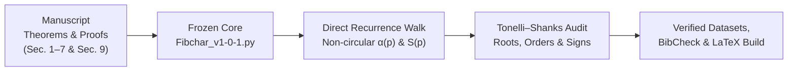
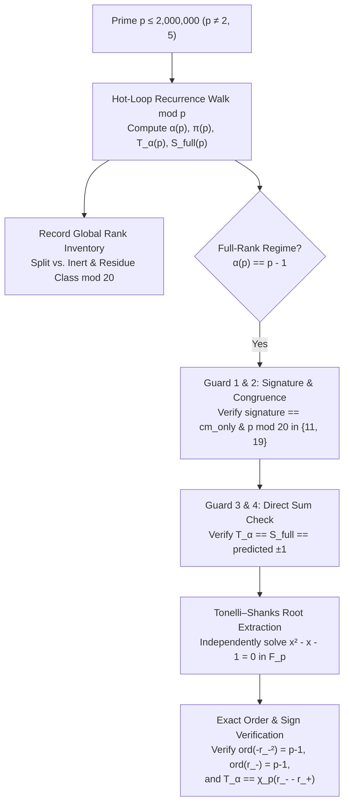
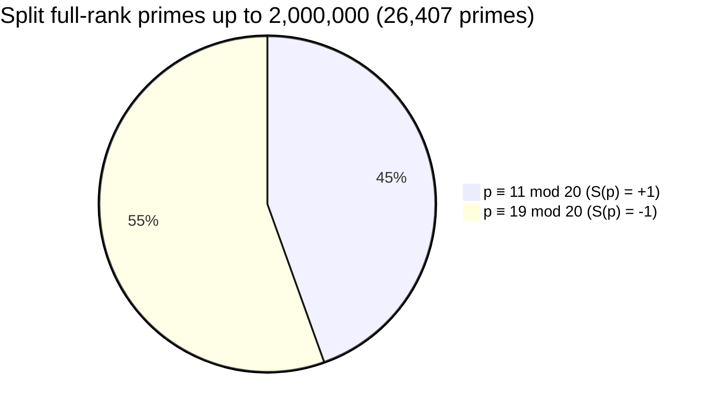
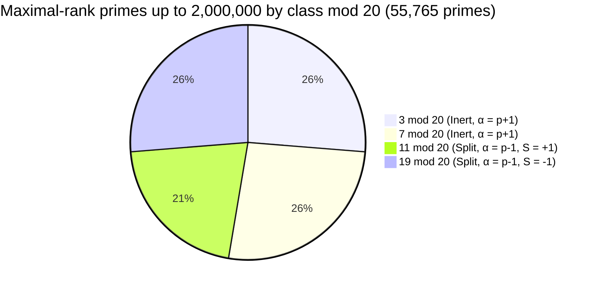

# An Explicit Evaluation of a Fibonacci Character Sum for Primes with Full Rank of Apparition

[](https://doi.org/10.5281/zenodo.21431565)
[](LICENSE)
[](https://creativecommons.org/licenses/by/4.0/)
[](https://www.python.org/)

> Reproducibility archive and exact-arithmetic verification suite for **“An Explicit Evaluation of a Fibonacci Character Sum for Primes with Full Rank of Apparition”** — primitive-root parametrization, cyclotomic sign determination, and GRH-conditional toric prime densities.

For a prime $p \ge 7$ with full Fibonacci rank of apparition $\alpha(p) = p - 1$, the accompanying manuscript proves unconditionally that $p \equiv 11 \text{ or } 19 \pmod{20}$ and evaluates the quadratic character sum $S(p) = \sum_{n=1}^{p-1} \chi_p(F_n)$ in closed form as $+1$ when $p \equiv 11 \pmod{20}$ and $-1$ when $p \equiv 19 \pmod{20}$. Under the Generalized Riemann Hypothesis (GRH), a specialization of Chen's toric density theorem combined with a self-contained three-range Hooley–Murty asymptotic sieve over $L_d = E_d\mathbb{Q}(\zeta_{20})$ establishes that full-rank primes have natural density $\frac{9A}{19}$ among all rational primes (and relative natural density $C_F = \frac{18A}{19}$ among primes splitting in $\mathbb{Q}(\sqrt{5})$), decomposing into $\frac{4A}{19}$ and $\frac{5A}{19}$ across the two residue classes, where $A$ is Artin's constant. This repository provides the frozen verification core (`FibChar v1.0.1`), exact-arithmetic finite-range tests for all primes $p \le 2 \times 10^6$, bibliography audit records, and build tools supporting the manuscript.

**Majid Ghandali** · Independent Researcher, Tehran, Iran · 2026

**Manuscript status:** Prepared for submission to the *Journal of Number Theory*.  
**Software & data archive DOI (`v1.0.1`):** [10.5281/zenodo.21431565](https://doi.org/10.5281/zenodo.21431565)  
**Previous software release DOI (`v1.0.0`):** [10.5281/zenodo.20707467](https://doi.org/10.5281/zenodo.20707467)  
**Manuscript preprint concept DOI:** [10.5281/zenodo.22803008](https://doi.org/10.5281/zenodo.22803008)  
*The software DOI `10.5281/zenodo.21431565` identifies the `FibChar v1.0.1` code and dataset archive; the manuscript preprint is maintained under a separate Zenodo record.*

---

## Why This Repository?

The accompanying manuscript proves the structural reduction, the closed-form sign evaluation, and the conditional natural-density asymptotics independently. This repository provides the non-circular implementation, step-by-step algebraic lemma checks, official census datasets, and build scripts supporting the reported computational results.



> [!IMPORTANT]
> The mathematical results are proved deductively in the accompanying manuscript. The computations in this repository test the implementation and verify the stated identities over the finite range $p \le 2 \times 10^6$; they do **not** replace the proofs.

---

## Repository at a Glance

| Item | Value |
|:--|:--|
| Mathematics | Quadratic Fibonacci character sums at full rank $\alpha(p) = p - 1$ & toric prime densities |
| Target journal | Prepared for submission to the *Journal of Number Theory* |
| Arithmetic | Exact modular and integer arithmetic in all mathematical kernels |
| Theoretical proofs | Accompanying manuscript (`manuscript/ghandali-FCS-Full-Rank_density.pdf`) |
| Computational role | Non-circular finite-range verification and empirical density consistency audit |
| Frozen core | `code/Fibchar_v1-0-1.py` (`FibChar v1.0.1`) |
| Full census range | $\pi(2 \times 10^6) = 148{,}933$ primes ($\pi^* = 148{,}931$ primes with $p \nmid 10$) |
| Full-rank split sample ($\mathcal{F}^+$) | $26{,}407$ primes with $\alpha(p) = p - 1$ ($0$ mismatches) |
| Maximal-rank total ($\mathcal{F}^+ \cup \mathcal{F}^-$) | $55{,}765$ primes with $\alpha(p) = p - \chi_p(5)$ across $p \equiv 3, 7, 11, 19 \pmod{20}$ |
| Licensing | Dual license: **MIT** (code/scripts) · **CC BY 4.0** (manuscript text, docs & datasets) |

The primary full-rank verification predicate is:

$$p \le 2 \times 10^6, \qquad p \ne 2, 5, \qquad \alpha(p) = p - 1.$$

---

## Quick Navigation

| Action | Link |
|:--|:--|
| ▶ Run a reproduction or self-test | [Quick Start](#quick-start) |
| 📐 Inspect main mathematical results | [Main Structural and Analytic Results](#main-structural-and-analytic-results) |
| 🧾 Review tested theoretical identities | [Theoretical Identities Tested](#theoretical-identities-tested-in-the-official-finite-computation) |
| 🔬 View verification workflow | [Verification Pipeline](#verification-pipeline) |
| 📊 Inspect census & density breakdown | [Key Results](#key-results) |
| 🥧 View residue-class distributions | [Maximal-Rank Census Reconciliation](#maximal-rank-census-reconciliation-remark-921) |
| 📁 Browse repository tree | [Repository Structure](#repository-structure) |
| 🔒 Verify frozen-core provenance | [Frozen Core](#frozen-core) |
| 📚 Citation & licensing | [Citation](#citation) |

---

## Contents

- [Quick Start](#quick-start)
- [Main Structural and Analytic Results](#main-structural-and-analytic-results)
- [Abstract](#abstract)
- [Mathematical Scope](#mathematical-scope)
- [Theoretical Identities Tested](#theoretical-identities-tested-in-the-official-finite-computation)
- [Verification Pipeline](#verification-pipeline)
- [Design Principles](#design-principles)
- [Installation](#installation)
- [Usage](#usage)
- [Official Run Configuration](#official-run-configuration)
- [Key Results](#key-results)
- [Maximal-Rank Census Reconciliation (Remark 9.21)](#maximal-rank-census-reconciliation-remark-921)
- [Outputs](#outputs)
- [Repository Structure](#repository-structure)
- [Frozen Core](#frozen-core)
- [Provenance and Hash Verification](#provenance-and-hash-verification)
- [Important Distinctions](#important-distinctions)
- [Reproducibility Policy](#reproducibility-policy)
- [Citation](#citation)
- [Contributing](#contributing)
- [License](#license)
- [Author](#author)

---

## Quick Start

From the repository root (`Paper5_JNT_density-upgrade/`):

```bash
python -m venv .venv
source .venv/bin/activate
# Windows PowerShell: .venv\Scripts\Activate.ps1

pip install numpy pandas numba pyarrow openpyxl

# 1. Run the instant self-test (5 worked examples from Appendix A)
python code/Fibchar_v1-0-1.py --self-test

# 2. Reproduce the full N = 2,000,000 census and Main Theorem verification
python code/Fibchar_v1-0-1.py \
  --no-gui \
  --N 2000000 \
  --verify-b1 \
  --parallel \
  --workers 8 \
  --chunk-size 5000 \
  --out-dir ./reproduced-run
```

To compile the LaTeX manuscript from the repository root (Windows PowerShell):

```powershell
powershell -NoProfile -ExecutionPolicy Bypass -File ".\tools\compile.ps1"
```

A successful full computational reproduction creates:

```text
reproduced-run/
├── fib_char_N2000000_db.csv
├── fib_char_N2000000_main_theorem.csv
├── fib_char_N2000000_root_order_sign_checks.csv
├── fib_char_N2000000_empirical_claims.csv
├── fib_char_N2000000_report.txt
├── fib_char_N2000000_report.xlsx
├── fib_char_N2000000_summary.json
└── latex_tables/
```

**Runtime note.** With `numba` enabled and $8$ parallel workers (LPT scheduling), the complete $N = 2 \times 10^6$ census and step-by-step root/order/sign verification complete in a few minutes on a modern multi-core workstation.

---

## Main Structural and Analytic Results

### 1. Unconditional Structural Reduction and Evaluation (Theorem 1.1)

Let $p \ge 7$ be a prime, let $\chi_p$ denote the quadratic character modulo $p$ (extended by $\chi_p(0) = 0$), and let $\alpha(p)$ denote the rank of apparition of $p$ in the Fibonacci sequence $(F_n)$:

$$\alpha(p) = \min\{m \ge 1 : p \mid F_m\}, \qquad S(p) = \sum_{n=1}^{p-1} \chi_p(F_n).$$

Under the full-rank hypothesis $\alpha(p) = p - 1$, the manuscript proves that $x^2 - x - 1$ splits over $\mathbb{F}_p$, $p \equiv 3 \pmod 4$, and the quadratic nonresidue root $r_- \in \mathbb{F}_p^\times$ is a primitive root of $\mathbb{F}_p^\times$. Reindexing $\mathbb{F}_p^\times$ via $n \mapsto u = r_-^n$ reduces $S(p)$ to a single character value, evaluated via fifth roots of unity:

$$S(p) = \chi_p(r_- - r_+) = \begin{cases} +1, & p \equiv 11 \pmod{20}, \\ -1, & p \equiv 19 \pmod{20}. \end{cases}$$

### 2. Conditional Natural-Density Asymptotics under GRH (Section 9)

Let $K = \mathbb{Q}(\sqrt{5})$ and $\eta = -\phi^2 = -\frac{3 + \sqrt{5}}{2} \in T(\mathbb{Q})$ on the norm-one algebraic torus $T = \ker\bigl(\mathrm{Res}_{K/\mathbb{Q}}\mathbb{G}_m \xrightarrow{N} \mathbb{G}_m\bigr)$. Specializing Chen's theorem (2002) and supplying a self-contained three-range Hooley–Murty asymptotic sieve over the Kummer–cyclotomic composita $L_d = E_d\mathbb{Q}(\zeta_{20})$ (using Serre's refined effective Chebotarev estimate under GRH and an unconditional Brun–Titchmarsh and Fibonacci-norm tail bound $\lvert N_{K/\mathbb{Q}}(\eta^m - 1)\rvert = 5F_m^2$), the manuscript proves under GRH:

$$\mathrm{den}(\mathcal{F}^+) = \frac{9A}{19} \approx 0.177137, \qquad C_F = \frac{\mathrm{den}(\mathcal{F}^+)}{\mathrm{den}\{p : \chi_p(5) = 1\}} = \frac{18A}{19} \approx 0.354274,$$

$$\delta_{11} = \frac{4A}{19} \approx 0.078728 \quad (S(p) = +1), \qquad \delta_{19} = \frac{5A}{19} \approx 0.098409 \quad (S(p) = -1),$$

$$\mathrm{den}(\mathcal{F}^-) = \frac{10A}{19} \approx 0.196818 \quad (\text{inert maximal-rank }\alpha(p) = p + 1,\ \delta_3 = \delta_7 = \frac{5A}{19}),$$

where $A = \prod_q \bigl(1 - \frac{1}{q(q-1)}\bigr) \approx 0.3739558136$ is Artin's constant.

---

## Abstract

Let $p \ge 7$ be a prime, let $\chi_p$ denote the quadratic character modulo $p$, and let $(F_n)$ be the Fibonacci sequence. The accompanying manuscript evaluates the character sum

$$S(p) = \sum_{n=1}^{p-1} \chi_p(F_n)$$

under the full-rank hypothesis $\alpha(p) = p - 1$. The hypothesis forces $x^2 - x - 1$ to split over $\mathbb{F}_p$, implies $p \equiv 3 \pmod 4$, and makes the nonresidue root $r_-$ of $x^2 - x - 1$ a primitive root of $\mathbb{F}_p^\times$. This yields a complete multiplicative parametrization of the Fibonacci indices and reduces the sum to

$$S(p) = \chi_p(r_- - r_+),$$

which equals $+1$ for $p \equiv 11 \pmod{20}$ and $-1$ for $p \equiv 19 \pmod{20}$. Under GRH, a specialization of a theorem of Chen on primitive points of one-dimensional tori, combined with the Hooley–Murty asymptotic sieve, shows that the primes with $\alpha(p) = p - 1$ have natural density $\frac{9A}{19}$ (equivalently, relative natural density $\frac{18A}{19}$ among primes split in $\mathbb{Q}(\sqrt{5})$), splitting into $\frac{4A}{19}$ for $p \equiv 11 \pmod{20}$ and $\frac{5A}{19}$ for $p \equiv 19 \pmod{20}$.

This repository contains the frozen verification code, exact-arithmetic checks, census tables, and build scripts for all primes $p \le 2 \times 10^6$.

---

## Mathematical Scope

The manuscript proves Theorem 1.1 unconditionally for all primes $p \ge 7$ with $\alpha(p) = p - 1$, and establishes the natural-density asymptotics in Section 9 conditionally under GRH for the Dedekind zeta functions $\zeta_{L_d}(s)$ of the Kummer–cyclotomic fields $L_d = E_d\mathbb{Q}(\zeta_{20})$.

The official finite computational census covers all primes satisfying:

$$p \le 2 \times 10^6, \qquad p \ne 2, 5.$$

Within this census of $\pi^* = 148{,}931$ primes, the step-by-step algebraic verification targets all $26{,}407$ full-rank primes satisfying $\alpha(p) = p - 1$, while the rank inventory tabulates all $55{,}765$ maximal-rank primes ($\alpha(p) = p - \chi_p(5)$) across the residue classes modulo $20$.

---

## Theoretical Identities Tested in the Official Finite Computation

The verification suite (`Fibchar_v1-0-1.py`) independently tests each intermediate lemma of the proof across all $26{,}407$ full-rank primes $p \le 2 \times 10^6$:

| Manuscript result | Ambient object | Tested identity / condition |
|:--|:--|:--|
| Lemma 3.1 | $\mathbb{F}_p^\times$ (multiplicative group) | Rank–order identity $\mathrm{ord}_{\mathbb{F}_p^\times}(-r_-^2) = \alpha(p)$ |
| Lemma 3.2 (a) | $\mathbb{F}_p$ and $\mathbb{Z}/4\mathbb{Z}$ | Splitting of $x^2 - x - 1$, $p \equiv 3 \pmod 4$, and $\{\chi_p(r_+), \chi_p(r_-)\} = \{+1, -1\}$ |
| Lemma 3.2 (b) | $\mathbb{F}_p^\times$ (multiplicative group) | Primitivity of the nonresidue root: $\mathrm{ord}_{\mathbb{F}_p^\times}(r_-) = p - 1$ |
| Proposition 5.1 | $\mathbb{Z}$ (integer character sums) | Structural reduction: $S(p) = \chi_p(r_- - r_+)$ |
| Lemma 6.3 | $\{\pm 1\}$ (quadratic character) | Cyclotomic sign law: $\chi_p(r_- - r_+) = +1$ ($11 \bmod 20$) or $-1$ ($19 \bmod 20$) |
| Theorem 1.1 | $\mathbb{Z}$ (integer character sums) | Closed-form evaluation: $S(p) = +1$ ($11 \bmod 20$) or $-1$ ($19 \bmod 20$) |
| Proposition 9.19 (a) | $(\mathbb{Z}/20\mathbb{Z})^\times$ (residue classes) | Support of maximal-rank primes restricted to $p \equiv 3, 7, 11, 19 \pmod{20}$ |

The corresponding algebraic chain verified per prime is:

$$\boxed{\begin{aligned} \alpha(p) = p - 1 &\Longrightarrow \chi_p(5) = +1 \text{ and } \chi_p(-1) = -1 \quad \bigl(p \equiv 11, 19 \pmod{20}\bigr) \\ &\Longrightarrow \chi_p(r_+) = +1,\ \chi_p(r_-) = -1 \quad \bigl(\text{roots in }\mathbb{F}_p^\times\bigr) \\ &\Longrightarrow \mathrm{ord}_{\mathbb{F}_p^\times}(-r_-^2) = \mathrm{ord}_{\mathbb{F}_p^\times}(r_-) = p - 1 \\ &\Longrightarrow S(p) = T_\alpha(p) = \chi_p(r_- - r_+) = \pm 1. \end{aligned}}$$

---

## Verification Pipeline

The computational workflow is strictly **non-circular**: both $\alpha(p)$ and $S(p)$ are computed by iterating the Fibonacci recurrence modulo $p$ from scratch, without assuming any closed-form formula.



---

## Design Principles

1. **Strictly non-circular verification**  
   Both $\alpha(p)$ and $S(p)$ are computed directly from their definitions before being compared against the theoretical predictions of Theorem 1.1.

2. **Multi-layer algebraic auditing**  
   Beyond checking the final value $S(p) = \pm 1$, the code independently extracts the roots $r_+, r_- \in \mathbb{F}_p$ via Tonelli–Shanks and verifies every intermediate lemma ($\mathrm{ord}_{\mathbb{F}_p^\times}(-r_-^2) = p - 1$, $\mathrm{ord}_{\mathbb{F}_p^\times}(r_-) = p - 1$, and $\chi_p(r_- - r_+)$).

3. **Immutable frozen core**  
   `code/Fibchar_v1-0-1.py` is frozen with a verified SHA-256 digest and permanent Zenodo DOI, serving as the foundational module for this project and companion studies.

4. **Reproducible build and bibliography tooling**  
   PowerShell automation scripts in `tools/` handle clean $4$-pass LaTeX compilation (`compile.ps1`) and cross-referenced DOI/metadata auditing (`BibCheck_v6.2.ps1`).

---

## Installation

The recorded official census was executed using:

```text
Python   3.12.7
NumPy    1.26.4
pandas   2.1.4
Numba    0.62.1
openpyxl 3.1.5
```

Install the required and optional packages:

```bash
pip install numpy pandas numba pyarrow openpyxl
```

---

## Usage

### 1. Reproduce the official $N = 2 \times 10^6$ census (parallel mode)

```bash
python code/Fibchar_v1-0-1.py \
  --no-gui \
  --N 2000000 \
  --verify-b1 \
  --parallel \
  --workers 8 \
  --chunk-size 5000 \
  --out-dir ./reproduced-run
```

### 2. Sequential execution with atomic checkpointing and resume

```bash
# Start sequential run (checkpoints every 2,000 primes):
python code/Fibchar_v1-0-1.py --no-gui --N 2000000 --verify-b1 --out-dir ./reproduced-run

# Resume an interrupted sequential run:
python code/Fibchar_v1-0-1.py --no-gui --N 2000000 --verify-b1 --resume --out-dir ./reproduced-run
```

### 3. Run the built-in Appendix A self-test ($p \in \{11, 19, 31, 59, 79\}$)

```bash
python code/Fibchar_v1-0-1.py --self-test
```

### 4. Compile the manuscript and run the bibliography audit

```powershell
# Compile manuscript/ghandali-FCS-Full-Rank_density.pdf:
powershell -NoProfile -ExecutionPolicy Bypass -File ".\tools\compile.ps1"

# Run the automated bibliography and DOI audit:
powershell -NoProfile -ExecutionPolicy Bypass -File ".\tools\BibCheck_v6.2.ps1"
```

---

## Official Run Configuration

```text
Script          : code/Fibchar_v1-0-1.py
Version token   : v1.0.1
N_max           : 2,000,000
Total primes    : 148,933  (148,931 with p != 2, 5)
Hot-loop mode   : Backend A (QR lookup table, exact int64/int8)
Root/order test : Exhaustive across all 26,407 full-rank primes
Verification    : Non-circular direct iteration + Tonelli-Shanks root audit
```

---

## Key Results

- **Audited primes ($p \le 2 \times 10^6,\ p \nmid 10$):** $\pi^* = 148{,}931$
- **Primes splitting in $\mathbb{Q}(\sqrt{5})$ ($p \equiv \pm 1 \pmod 5,\ p > 5$):** $74{,}408$
- **Split full-rank primes ($\alpha(p) = p - 1$):** $26{,}407$
- **Main Theorem mismatches / Lemma verification failures:** $0$

| $p \bmod 20$ | Predicted $S(p)$ | Observed Count | Matches | Mismatches | Status |
|:--:|:--:|--:|--:|--:|:--:|
| $11$ | $+1$ | $11{,}755$ | $11{,}755$ | $0$ | **PASS** |
| $19$ | $-1$ | $14{,}652$ | $14{,}652$ | $0$ | **PASS** |
| **Total** | | **$26{,}407$** | **$26{,}407$** | **$0$** | **PASS** |



- **Observed relative proportion among split primes:** $\dfrac{26{,}407}{74{,}408} \approx 0.354895$ ($35.49\%$)
- **Theoretical GRH relative natural density:** $C_F = \dfrac{18A}{19} \approx 0.354274$ ($35.43\%$)
- **Deviation:** $+46.2$ primes ($6.2 \times 10^{-4}$ absolute difference; $0.18\%$ relative difference; heuristic Poisson diagnostic ratio $+0.28\sigma$).

---

## Maximal-Rank Census Reconciliation (Remark 9.21)

Across all $\pi^* = 148{,}931$ primes $p \le 2 \times 10^6$ with $p \nmid 10$ (where $A\pi^* \approx 55{,}693.6$), the $55{,}765$ maximal-rank primes ($\alpha(p) = p - \chi_p(5)$) partition into the four admissible residue classes modulo $20$ as follows:

$$55{,}765 = \underbrace{26{,}407}_{\mathcal{F}^+\text{ (split, }\alpha(p)=p-1\text{)}} + \underbrace{29{,}358}_{\mathcal{F}^-\text{ (inert, }\alpha(p)=p+1\text{)}}.$$

| $c \pmod{20}$ | Branch | Maximal-Rank Condition | Count ($N_c$) | $N_c / (A\pi^*)$ | GRH Predicted ($c_i / 19$) |
|:--:|:--:|:--:|--:|:--:|:--:|
| $3$ | Inert ($\mathcal{F}^-$) | $\alpha(p) = p + 1$ | $14{,}656$ | $0.2632$ | $5/19 \approx 0.2632$ |
| $7$ | Inert ($\mathcal{F}^-$) | $\alpha(p) = p + 1$ | $14{,}702$ | $0.2640$ | $5/19 \approx 0.2632$ |
| $11$ | Split ($\mathcal{F}^+$) | $\alpha(p) = p - 1$ | $11{,}755$ | $0.2111$ | $4/19 \approx 0.2105$ |
| $19$ | Split ($\mathcal{F}^+$) | $\alpha(p) = p - 1$ | $14{,}652$ | $0.2631$ | $5/19 \approx 0.2632$ |
| **Total** | $\mathcal{F} = \mathcal{F}^+ \cup \mathcal{F}^-$ | $\alpha(p) = p - \chi_p(5)$ | **$55{,}765$** | **$1.0013$** | **$19/19 = 1.0000$** |



No maximal-rank prime occurs in any other residue class modulo $20$, in exact agreement with Proposition 9.19(a).

---

## Outputs

| Directory | Content | Purpose |
|:--|:--|:--|
| `results/` | Official CSV census database and Main Theorem verification summary | Primary numerical evidence cited in the manuscript |
| `manuscript/` | LaTeX source (`.tex`), BibTeX (`.bib`), and compiled article (`.pdf`) | Authoritative mathematical text and proofs |
| `docs/bibcheck_output/` | Automated DOI, metadata, and citation audit tables | Bibliographic integrity verification |

### Primary Data and Audit Files

| File | Content |
|:--|:--|
| `results/fib_char_db_N2000000.csv` | Complete $22$-column census database for all $148{,}933$ primes $p \le 2 \times 10^6$ |
| `results/corollary_B1_verification.csv` | Summary verification table for $p \equiv 11, 19 \pmod{20}$ (Table 1 of manuscript) |
| `docs/bibcheck_output/.../bibcheck_audit.xlsx` | Complete multi-sheet bibliographic verification workbook |
| `docs/bibcheck_output/.../citation_audit.csv` | Cross-check of in-text `\cite{...}` keys against `.bib` entries |
| `docs/bibcheck_output/.../doi_resolution.csv` | Live DOI resolution and metadata verification log |

---

## Repository Structure

```text
Paper5_JNT_density-upgrade/
├── code/
│   └── Fibchar_v1-0-1.py                     # Canonical frozen verification core (v1.0.1)
│
├── results/
│   ├── fib_char_db_N2000000.csv              # Official 2,000,000-prime census dataset
│   └── corollary_B1_verification.csv         # Main Theorem verification summary
│
├── manuscript/
│   ├── ghandali-FCS-Full-Rank_density.tex    # Manuscript LaTeX source (elsarticle class)
│   ├── ghandali-FCS-Full-Rank_density.bib    # Manuscript BibTeX bibliography
│   └── ghandali-FCS-Full-Rank_density.pdf    # Compiled manuscript PDF
│
├── tools/
│   ├── compile.ps1                           # Reproducible PowerShell LaTeX build script
│   └── BibCheck_v6.2.ps1                     # Automated BibTeX & DOI audit pipeline
│
├── docs/
│   ├── COMPILE.txt                           # Build notes and compilation instructions
│   ├── bib_check_README.md                   # Documentation for the BibCheck audit tool
│   └── bibcheck_output/                      # Timestamped bibliography verification records
│
├── submission/                               # Local journal submission staging package
│   ├── Cover_Letter.tex
│   ├── Cover_Letter.pdf
│   ├── Highlights.txt
│   ├── ghandali-FCS-Full-Rank_density.tex
│   ├── ghandali-FCS-Full-Rank_density.bib
│   ├── ghandali-FCS-Full-Rank_density.bbl
│   └── ghandali-FCS-Full-Rank_density.pdf
│
├── CITATION.cff                              # Citation metadata (synchronized with v1.0.1)
├── LICENSE                                   # Dual-license terms (MIT for code, CC BY 4.0 for text/data)
├── .gitignore                                # Excludes build cache & copyrighted third-party PDFs
└── README.md                                 # Primary repository documentation
```

### Files of Primary Interest

| File | Role |
|:--|:--|
| `code/Fibchar_v1-0-1.py` | Immutable verification core (`FibChar v1.0.1`) |
| `results/fib_char_db_N2000000.csv` | Official $N = 2 \times 10^6$ prime census dataset |
| `manuscript/ghandali-FCS-Full-Rank_density.tex` | Authoritative LaTeX source of the manuscript |
| `tools/compile.ps1` | Automated $4$-pass LaTeX/BibTeX build script |
| `tools/BibCheck_v6.2.ps1` | Automated bibliography and DOI verification script |

> [!NOTE]
> **Third-party reference directories (`literature/` and `classification/`):** Local working directories containing third-party reference PDFs (`literature/` and `classification/MSC_2020_Number-Theory.pdf`) are used strictly for private scholarly reference during research. They are excluded via `.gitignore` and **not redistributed** in the public repository or Zenodo archive in compliance with publisher copyright policies.

---

## Frozen Core

The verification script `code/Fibchar_v1-0-1.py` is frozen at release `v1.0.1` and serves as the immutable computational core for this work and subsequent companion studies on rank-block reflections.

```text
File     : code/Fibchar_v1-0-1.py
Token    : v1-0-1
Version  : v1.0.1
SHA-256  : D11BCB1C02414003345B00D5572EE201A2DAD4DCD0F3950BF76189BFE2CCA353
DOI      : 10.5281/zenodo.21431565
```

---

## Provenance and Hash Verification

To verify the cryptographic integrity of the frozen core and primary dataset from the repository root:

```powershell
# Windows PowerShell
Get-FileHash -Path ".\code\Fibchar_v1-0-1.py", ".\results\fib_char_db_N2000000.csv" -Algorithm SHA256
```

```bash
# Linux / macOS
sha256sum code/Fibchar_v1-0-1.py results/fib_char_db_N2000000.csv
```

Bibliographic hash records and DOI resolution logs for all $42$ manuscript references are archived under `docs/bibcheck_output/bibcheck-v6.2-20261115_233606-348c87f2/source_hashes.csv`.

---

## Important Distinctions

> [!IMPORTANT]
> These distinctions govern the mathematical and archival interpretation of this repository.

1. **Unconditional evaluation versus conditional natural density**  
   Theorem 1.1 ($S(p) = \pm 1$ for $\alpha(p) = p - 1$) is proved **unconditionally**. The natural-density asymptotics in Section 9 ($\mathrm{den}(\mathcal{F}^+) = \frac{9A}{19}$ and $C_F = \frac{18A}{19}$) are proved **conditionally under GRH** for the Dedekind zeta functions $\zeta_{L_d}(s)$ of $L_d = E_d\mathbb{Q}(\zeta_{20})$ (while the large-prime rank-index tail in Lemma 9.18 is bounded unconditionally).

2. **Absolute natural density versus relative split density**  
   The constant $\frac{9A}{19} \approx 0.177137$ is the natural density of the split full-rank primes among *all* rational primes, whereas $C_F = \frac{18A}{19} \approx 0.354274$ is their relative natural density within the set of primes splitting in $\mathbb{Q}(\sqrt{5})$ (which itself has natural density $\frac{1}{2}$).

3. **Deductive proofs versus finite-range computational checks**  
   The manuscript proves all theorems deductively. The $N = 2 \times 10^6$ census provides a non-circular verification of Theorem 1.1 and a finite-scale consistency check for the leading density constants, not a substitute for an unconditional proof of Conjecture 10.1.

4. **Software/data archive DOI versus manuscript preprint DOI**  
   The DOI `10.5281/zenodo.21431565` identifies the **software and dataset reproducibility archive (`FibChar v1.0.1`)**. The manuscript preprint is archived separately at Zenodo (concept DOI: `10.5281/zenodo.22803008`). These two persistent identifiers must not be used interchangeably.

5. **Direct verification cost versus order-testing complexity**  
   Computing $S(p)$ directly from its definition takes $O(p)$ operations per prime to guarantee non-circularity, whereas testing $\alpha(p) = p - 1$ alone reduces to testing whether $\bar{\eta} = -\bar{r}^2$ generates $\mathbb{F}_p^\times$ in $p^{o(1)}$ bit operations once $p - 1$ is factored (Remark 8.2).

---

## Reproducibility Policy

Every numerical count, table entry, and consistency check reported in Section 8, Remark 9.21, and Appendix A of the manuscript can be reproduced directly from `code/Fibchar_v1-0-1.py` and inspected in `results/fib_char_db_N2000000.csv`.

The accompanying manuscript (`manuscript/ghandali-FCS-Full-Rank_density.pdf`) remains the authoritative source for all theorem statements, hypotheses, and proofs.

---

## Citation

Citation metadata is provided in [`CITATION.cff`](CITATION.cff) (synchronized with `FibChar v1.0.1`). To cite the reproducibility archive in BibTeX:

```bibtex
@misc{Ghandali2026,
  author       = {Ghandali, Majid},
  title        = {{FibChar v1.0.1}: Reproducibility Archive for ``An Explicit Evaluation of a {F}ibonacci Character Sum for Primes with Full Rank of Apparition''},
  howpublished = {Zenodo},
  year         = {2026},
  version      = {v1.0.1},
  doi          = {10.5281/zenodo.21431565},
  url          = {[https://doi.org/10.5281/zenodo.21431565](https://doi.org/10.5281/zenodo.21431565)},
  note         = {Reproducibility archive}
}
```

---

## Contributing

- Report reproducibility questions or issues through the repository issue tracker.
- The frozen core `code/Fibchar_v1-0-1.py` (`v1.0.1`) is immutable and must not be modified.
- Pull requests that alter the frozen core or modify official verification outputs will be declined.

---

## License

This repository is distributed under a dual-licensing policy (see [`LICENSE`](LICENSE)):

- **Source Code and Automation Scripts (`code/`, `tools/`):** Licensed under the [MIT License](https://opensource.org/licenses/MIT).
- **Manuscript Text, Documentation, and Datasets (`manuscript/`, `results/`, `docs/`, `README.md`):** Licensed under the [Creative Commons Attribution 4.0 International License (CC BY 4.0)](https://creativecommons.org/licenses/by/4.0/).
- **Private Reference Literature (`literature/`, `classification/`):** Excluded from public distribution (`not redistributed`); all rights remain with their respective copyright holders.

---

## Author

**Majid Ghandali**  
Independent Researcher, Tehran, Iran  
Email: [majid.ghandali@gmail.com](mailto:majid.ghandali@gmail.com)  
ORCID: [0009-0001-1097-1770](https://orcid.org/0009-0001-1097-1770)
